# Lead Engine for n8n

An n8n system that answers every new lead in seconds, scores it, files it in HubSpot, follows up until the lead replies, and shows the team a live speed-to-lead board.

Built for **Halden Solar Co.**, a fictional rooftop-solar installer in Lahore. The business is made up; the workflows, the HubSpot CRM, the emails and the test results are real.

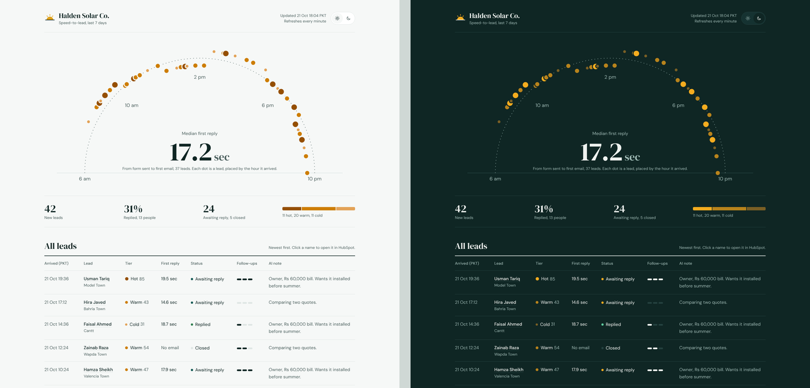

---

## What it does

1. **Takes a lead** from a branded quote form, or from any website form that can send a POST request.
2. **Checks it:** cleans the text, rejects junk and bots, and ignores exact repeats.
3. **Scores it** from 0 to 100 on monthly bill, timeline, property type and ownership. An optional AI note can move the score by at most 10 points.
4. **Files it in HubSpot,** creating the contact or updating the existing one, never a duplicate.
5. **Replies instantly** by email. In live tests the first reply landed 15 to 19 seconds after the form was sent.
6. **Alerts the team** about hot leads (score 70 and up), with one-tap call and HubSpot buttons.
7. **Follows up** on day 1, day 3 and day 7, and **stops the moment the lead replies**. The team gets a "they replied" alert.
8. **Reports:** a daily 8 am digest email, and a live board showing median first-reply time, every lead placed on a sun arc by the hour it arrived, tiers and pipeline.

## What it replaces

A salesperson checking a form inbox, copying details into a CRM, deciding who to call first, writing the same reply again and again, and keeping a follow-up list in their head. Replying within minutes instead of hours is the part people most often miss when they do this by hand.

## How it works

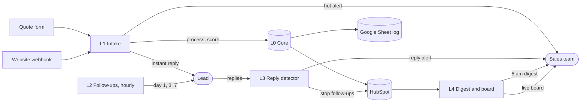

| Workflow | Job |
|---|---|
| **L0 Core** | The shared toolbox the other workflows call: validate and score a lead, upsert or update a HubSpot contact, write a log row. One place for the rules, so every entry point behaves the same. |
| **L1 Intake** | Form or webhook in → L0 checks and scores → repeat guard → HubSpot → instant reply → optional AI note (re-score, clamped) → hot-lead alert. |
| **L2 Follow-ups** | Hourly. Finds leads still waiting, sends follow-up 1, 2 or 3, and closes the lead after 3. Each stage is saved before its email is sent, so a crash can never send the same follow-up twice. |
| **L3 Reply detector** | Watches the inbox over IMAP. When a known lead replies, marks them "replied" in HubSpot (which stops follow-ups) and alerts the team. Ignores auto-replies and the system's own mail. |
| **L4 Digest and board** | The 8 am digest email, and the board page at `/webhook/halden-board`. |
| **L5 Stress test** | Runs 500 generated leads through the real L0 rules and HubSpot, with the AI mocked and no lead emails sent, then writes a pass/fail report. |
| **L5b Cleanup** | Deletes the stress test's HubSpot contacts afterwards. |
| **e0 Error alerts** | Emails you when any workflow fails. |

Data lives in **HubSpot** (contacts and lead fields) and a **Google Sheet** (the engine's own log: an `Events` tab for the repeat guard, `Rejects`, `TestReport`).

## What it handles

- **Bad input:** missing contact details, malformed emails, non-local phone numbers, invisible and control characters, oversized text, objects where text should be. Spreadsheet formulas typed into the form are stored as plain text, never run.
- **Bots:** website submissions that fill the hidden honeypot field (`website`) are rejected.
- **Duplicates:** an exact repeat is ignored. The same person sending a new message updates their contact instead of creating a second one. Phone-only leads get their own unique key.
- **The AI misbehaving:** the AI note is optional. If the AI fails, times out or returns nonsense, the lead keeps its rule-based score. The AI can never move a score by more than 10 points.
- **Crashes mid-run:** follow-up stages are saved before sending, and repeats are guarded, so a retry doesn't double-send.
- **Replies:** detects real replies, skips auto-replies and out-of-office mail, and dedupes several replies from one lead in a single check.
- **Failures:** every workflow reports errors to e0.

## How it was tested

- **500-lead stress test (L5), against the real HubSpot account:** **500/500 passed.**
  - 380 contacts created, with 380 distinct contact IDs (no duplicates).
  - 367 first replies, exactly one per contact with an email.
  - 0 AI moves larger than 10 points.

  | Category | Result |
  |---|---|
  | Accepted | 303/303 |
  | Repeat or update | 56/56 |
  | AI nudge clamped | 43/43 |
  | Rejected, no valid contact | 30/30 |
  | Truncated input | 21/21 |
  | Missing name | 19/19 |
  | Spam (honeypot) | 15/15 |
  | Phone only | 13/13 |
- **Workflow engine test:** 14 of 14 scenarios passed across 113 real n8n executions, with external services mocked.
- **Code tests** (in `tests/`, plain Node.js): 15,890 checks on the rules, 3,299 on intake, plus follow-up timing over a simulated 14 days and reply detection. A deliberate sabotage check confirms a broken AI limit is caught.
- **Live run:** real form submissions through to Gmail. The first reply arrived in 15 to 19 seconds.

Run the code tests yourself:

```bash
cd tests
node test_core.js && node test_l0.js && node test_l1.js && node test_l2.js && node test_l3.js && node test_l5.js
```

## Sample output

All people, emails and phone numbers shown are fake. The board and the four-email overview are renders of this repo's code with sample data; everything else is a screenshot of the running system.

**Board**, light and dark (it follows the viewer's system setting; the sun/moon switch overrides it)


| | |
|---|---|
| Board on a phone | 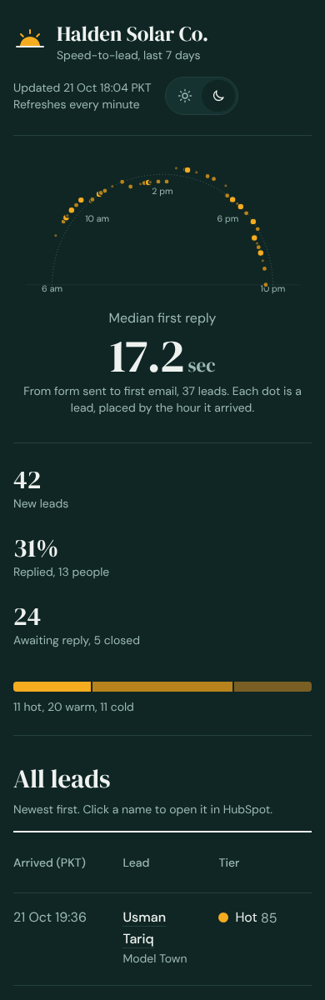 |
| Quote form, light | 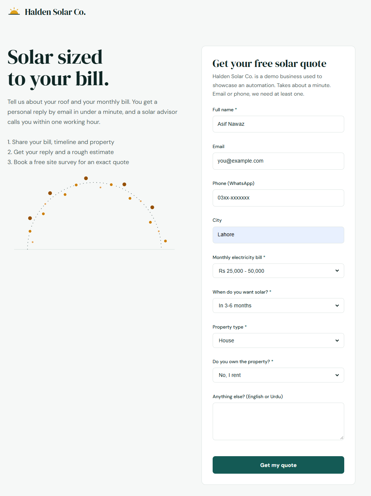 |
| Quote form, dark | 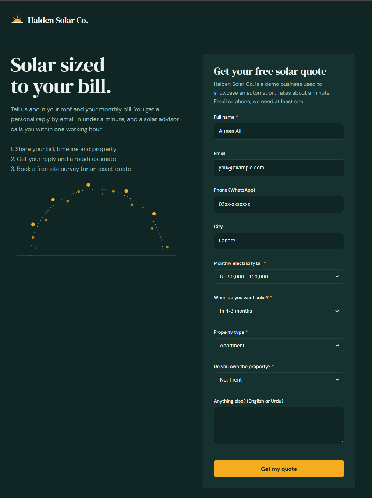 |
| Thank-you page, light | 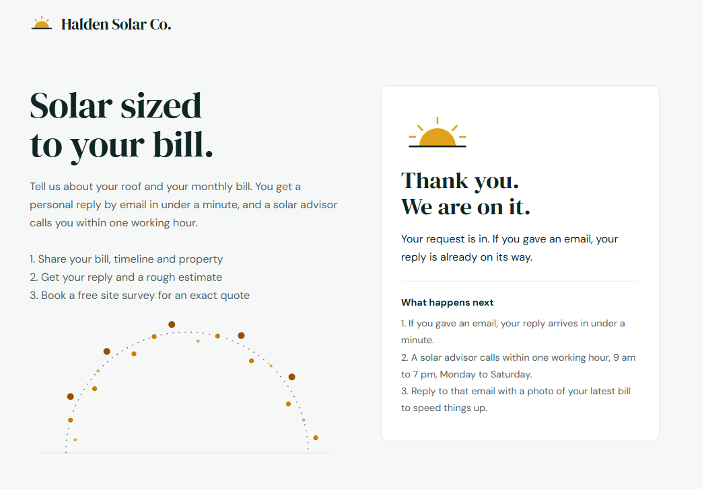 |
| Thank-you page, dark | 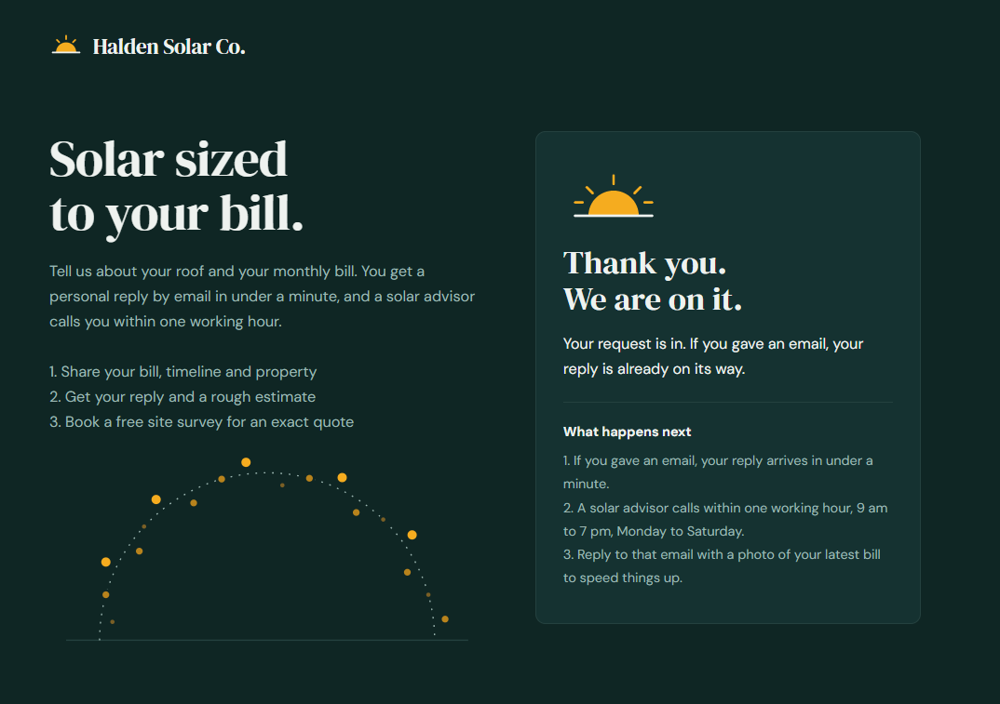 |
| Instant reply | 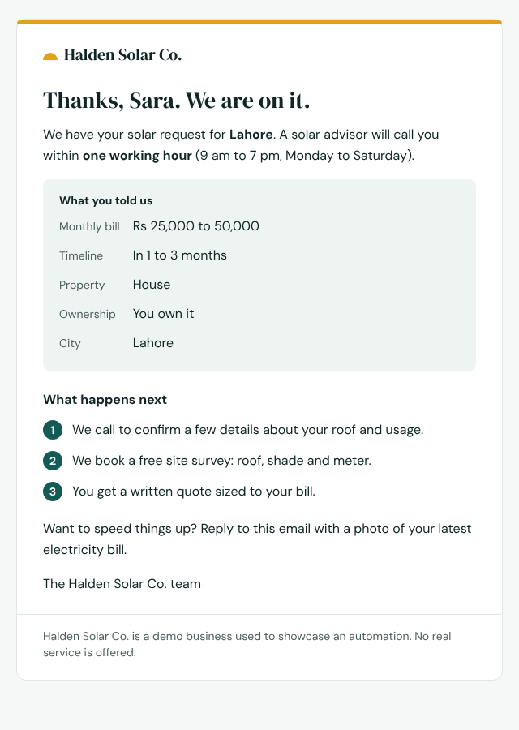 |
| Hot-lead alert | 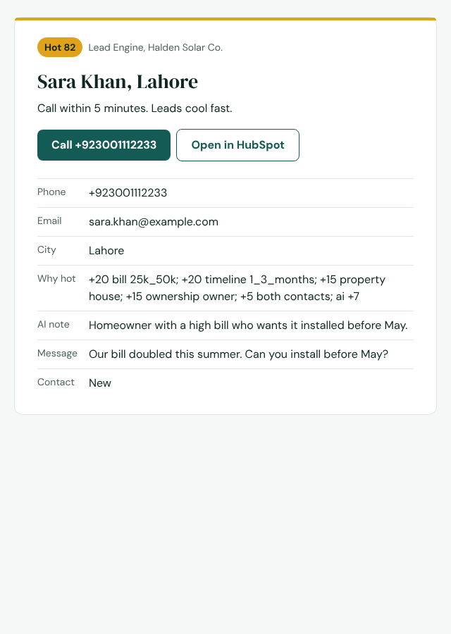 |
| All four emails: reply, hot alert, reply alert, digest | 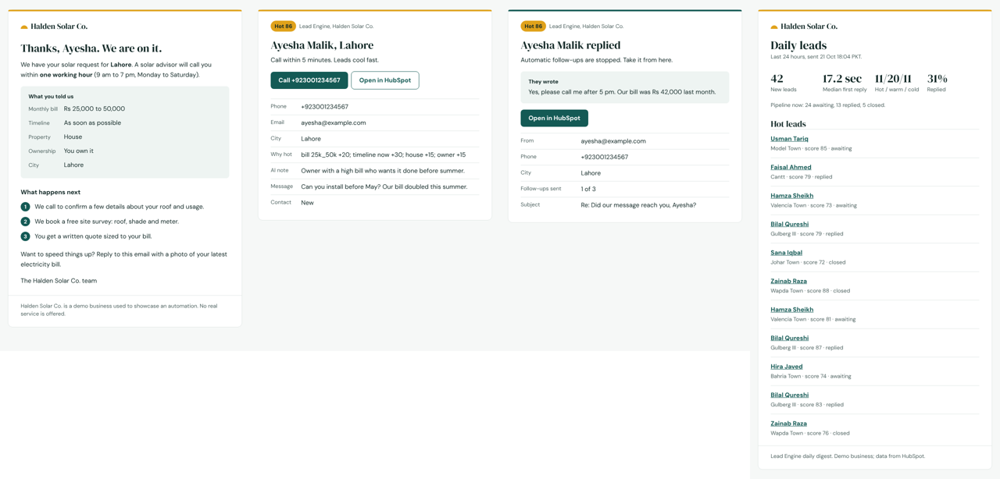 |
| HubSpot contacts with the Lead Engine fields | 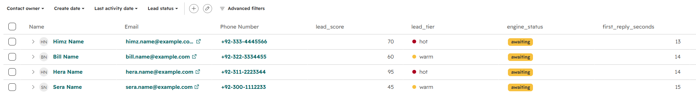 |
| Sheet Overview tab | 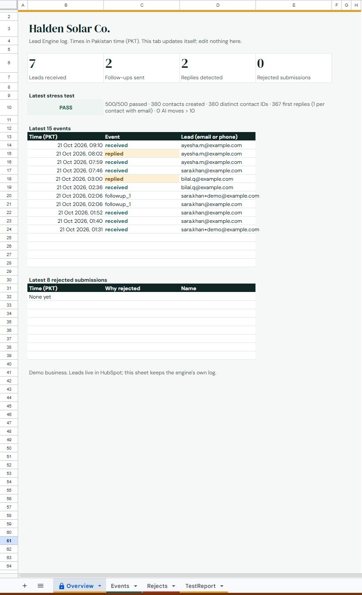 |
| Stress-test report, 500/500 | 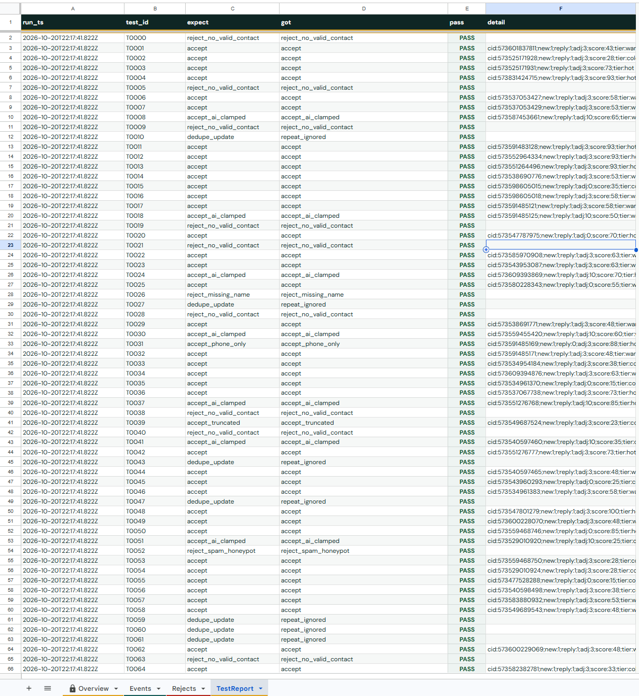 |
| Intake workflow (L1) | 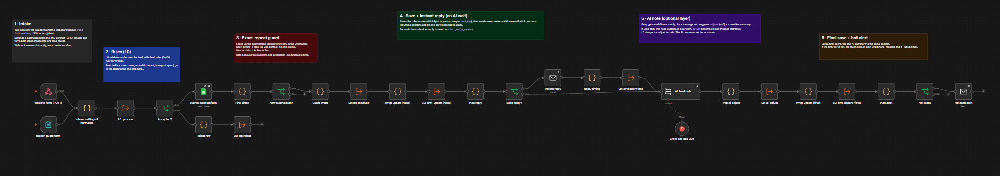 |
| Core workflow (L0) | 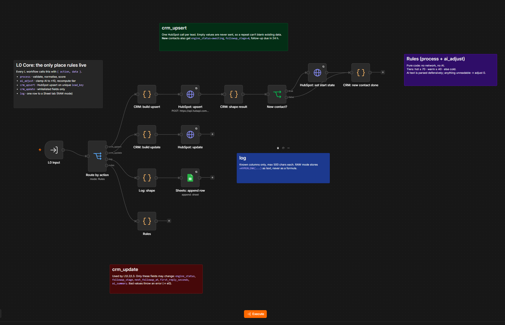 |

## Setup

You need: self-hosted **n8n 2.x**, a free **HubSpot** account, a **Google Sheet** with a service account, a **Gmail** address with an app password (SMTP to send, IMAP to read replies), and optionally a **Groq** API key for the AI note.

1. **HubSpot.** Create a service key with contact read and write access. Then add these contact properties (one group, for example "Lead Engine"):

   | Property | Type |
   |---|---|
   | `lead_key` | Single-line text, **unique** |
   | `lead_score` | Number |
   | `lead_tier` | Single-line text |
   | `score_reasons` | Multi-line text |
   | `ai_summary` | Single-line text |
   | `first_reply_seconds` | Number |
   | `followup_stage` | Number |
   | `engine_status` | Dropdown: awaiting, replied, closed |
   | `next_followup_at` | Date and time |

2. **Google Sheet.** Create three tabs with these headers in row 1:
   - `Events`: idempotency_key, dedupe_key, event, ts
   - `Rejects`: ts, errors, name, email, phone, test_id
   - `TestReport`: run_ts, test_id, expect, got, pass, detail

   Share the sheet with your service account. Optional: paste `sheet/HaldenSheet.gs` into Extensions → Apps Script and run `setupHaldenSheet`. It styles the tabs and adds a self-updating Overview tab.
3. **Import the workflows** from `workflows/` in this order: e0, L0, L1, L2, L3, L4, L5, L5b. `workflows/README.md` lists what to fill in on each.
4. **Connect credentials** on every node that shows a warning: HubSpot (service key), Google Sheets (service account), SMTP and IMAP (Gmail app password), Groq.
5. **Fill in the settings.** Replace `PASTE_YOUR_SHEET_ID` in each Google Sheets node with your sheet's ID. Then edit the settings block at the top of these Code nodes:
   - L1 "Intake: settings & normalize"
   - L2 "Settings"
   - L3 "Settings & parse"
   - L4 "Queries"
   - L5 "Load 500 test leads"

   Each needs L0's workflow ID (from L0's URL), your sending email, the team alert email, and optionally your HubSpot portal ID. The portal ID makes names clickable.
6. **Set error alerts.** In each workflow's settings, pick e0 as the error workflow.
7. **Publish** L0, L1, L2, L3 and L4. Open the form's production URL and send a test lead, or send `examples/sample-lead.json` to the webhook. The board is at `https://<your-n8n>/webhook/halden-board`.

## Configuring for other markets

- **Scoring and bill bands:** the `BILL`, `TIMELINE`, `PROPERTY` and `OWNER` tables at the top of L0's "Rules" node. The bill bands are in Pakistani rupees; change the keys there and the matching labels in L1's normalize map and the form's dropdown.
- **Phone format:** `normPhone` in L0 "Rules" accepts Pakistani mobiles. Swap it for your country's format.
- **Follow-up timing:** `WAIT_AFTER` in L2 "Plan follow-ups".
- **Hot threshold:** 70 and up is hot, 40 and up is warm, in L0 "Rules".
- **Wording and branding:** the email copy sits in L1 "Plan reply", L1 and L3 "Plan alert", L2 "Plan follow-ups", L4 "Build page / email". Form styling is in `design/form.css`, generated by `design/make_form_css.js`.
- **Time zone:** the board and digest show Pakistan time (UTC+5). Change `PKT` in L4.

## Known limits

- **The public form needs abuse protection before real traffic.** Add a CAPTCHA or a rate limit in front of it.
- **Bursts queue up.** With a slow AI response and n8n's concurrency set to 1, a burst of leads is processed one at a time.
- **Returning contacts get no instant reply.** By design, someone already in HubSpot isn't sent the welcome email again; the team still gets alerts.
- **Reply detection matches the exact sending address.** A lead replying from a different address isn't recognised.
- **Alerts need internet.** If the machine running n8n is offline, e0 alerts can't go out.
- **The board and webhooks have no login.** Keep n8n on localhost or behind authentication.
- **The AI note is a nudge, not a judge.** Scores are rules-first by design.

## Repo map

```
workflows/   the 8 n8n workflows to import (see workflows/README.md for order and settings)
tests/       code tests that run the workflows' own Code-node source (see tests/README.md)
examples/    a sample lead and a curl command for the webhook
sheet/       Apps Script that styles the Google Sheet and builds its Overview tab
design/      the form's CSS and the script that generates it
docs/        screenshots and renders used in this README
```

## License

MIT. See `LICENSE`.
